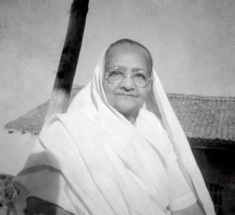

# Living Portraits

Bring an old family photo to the ofrenda. Living Portraits mends its creases, returns its colour
and gives it depth, using only open-source models on a server you control.

**The face is never moved, re-posed or given words.** The photo comes back to life through
light, colour and depth instead.

Built for the DEV Hacktoberfest Open-Source AI Challenge, Week 4: *Ghost in the Machine*.



## The Return

When a photo is placed on the altar, the page plays one short sequence on a WebGL canvas:

1. The photo appears as it is today: faded, creased, black and white.
2. A line of candlelight sweeps down and mends it.
3. Colour blooms outward from the person's face.
4. The portrait settles into depth. It shifts gently with your cursor or as you tilt your phone,
   and candlelight flickers brighter on what is nearer.

The page can record the Return as a video to keep or share.

## The pipeline

| Step | Model | Licence |
|---|---|---|
| Mend | [GFPGAN v1.4](https://github.com/TencentARC/GFPGAN) (+ [Real-ESRGAN](https://github.com/xinntao/Real-ESRGAN) on GPU) | Apache-2.0 / BSD-3 |
| Colour | [DDColor](https://github.com/piddnad/DDColor) (predicts colour only; light and detail come from the original) | Apache-2.0 |
| Depth | [Depth Anything V2 Small](https://huggingface.co/depth-anything/Depth-Anything-V2-Small-hf) | Apache-2.0 |
| Check | [facexlib](https://github.com/xinntao/facexlib) RetinaFace + ArcFace: compares the face before and after | MIT |

The restored face is blended with the original (`weight=0.6`) so the person keeps looking like
themselves, and the ArcFace check measures it.

## Results

Five public-domain portraits from Wikimedia Commons (`samples/`):

| | Laptop (RTX 3050, 4 GB) | DigitalOcean CPU Droplet (4 vCPU, 8 GB) |
|---|---|---|
| Time per photo (median) | 6.2 s | 11.7 s |
| Identity, ArcFace cosine (median) | 0.95 | 0.95 |

The lowest identity score (0.74) is Rabindranath Tagore's side profile: face models find profiles
harder. On the Droplet ($0.125 an hour), one photo costs about $0.0004 of compute.

## Run it

**DigitalOcean Droplet** (Ubuntu 24.04, GPU optional):

```bash
git clone <this repo> /opt/lp/app
sudo bash /opt/lp/app/server/setup.sh
sudo cp /opt/lp/app/server/living-portraits.service /etc/systemd/system/
sudo systemctl enable --now living-portraits     # serves on port 80
```

**Windows laptop with an NVIDIA GPU:**

```powershell
powershell -ExecutionPolicy Bypass -File server\setup_windows.ps1
cd server; ..\.local\venv\Scripts\uvicorn app:app --port 8000
```

**Evaluate a folder of photos, and render the Return as a GIF:**

```bash
python server/evaluate.py samples/ --out results/
python server/render_return.py results/Kasturba_Gandhi --face 0.54,0.37 --out docs/media/kasturba-return
```

## Licences and credits

Code in this repo: MIT. Model licences belong to their authors (table above). Sample photos are
public domain, from Wikimedia Commons. Family photos used in the write-up are shared with permission.
