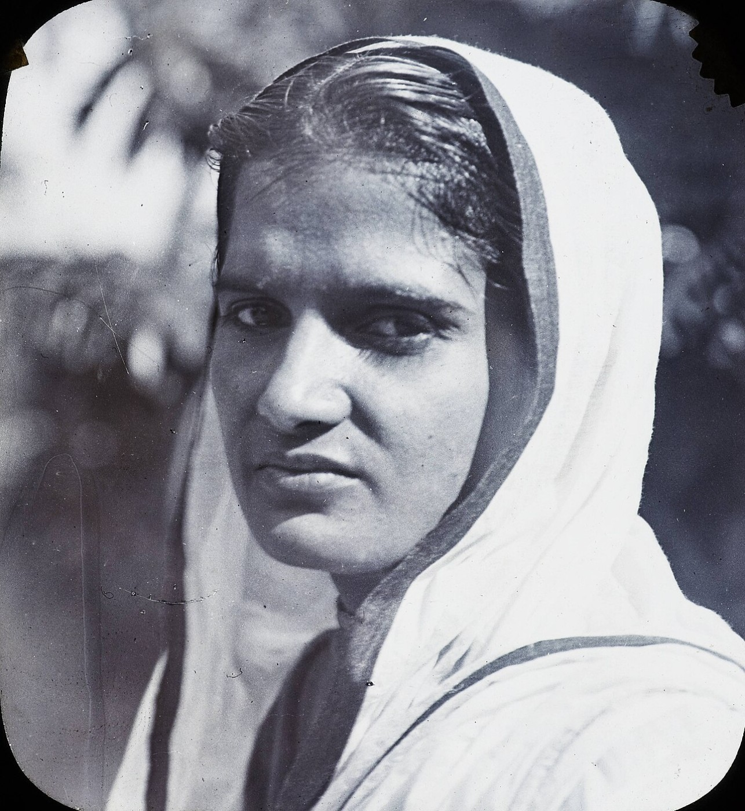
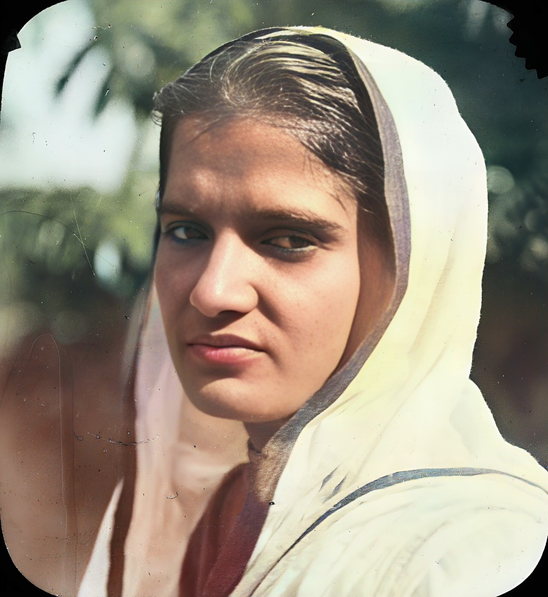
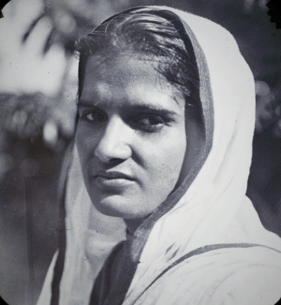

*This is a submission for the [Hacktoberfest Open-Source AI Challenge Week 4: Ghost in the Machine](https://dev.to/challenges/hacktoberfest-week4-2026-10-26)*

There is an idea from Día de los Muertos that I keep coming back to.

A person dies three times. Once when their body stops. Once when they are buried. And a final time, when the last person who remembers them is gone.

I went looking for a photograph of my great-grandparents to put on an ofrenda. There isn't one. Nobody in my family has a single picture of them. I don't know their faces at all.

So I went to the public archives instead, and found page after page of people in the same situation as my great-grandparents. Portraits from India, a hundred years old and more, labelled with a single line:

*Unidentified woman.*

*Milk-woman, studio photograph.*

*Indian Christian, India, ca. 1910.*

Someone loved each of these people. Someone paid for that photograph, dressed them in their best clothes, told them to hold still. And now nobody knows their names.

So I built them an altar.





*A woman photographed for a lantern slide around 1910. Her name was not recorded. Above, the photo as it survives. Below, the same photo after Living Portraits.*

## What I Built

**Living Portraits** is a digital ofrenda for old photographs. You place a photo on the altar, and it comes back to you in one short sequence I call *the Return*:

1. The photo appears as it is today: faded, creased, black and white.
2. A thin line of candlelight passes down the photo and mends it.
3. Colour spreads outward from the person's face, the way a memory comes back.
4. The portrait settles into depth. Move your cursor, or tilt your phone, and it shifts gently, as if you were standing in front of a real print, while candlelight flickers brighter on whatever is nearest to you.



Under every portrait is everything we know about them, which is often almost nothing. A name if there is one. *Her name was not recorded* if there isn't. A link to the archive the photo came from and its licence, so you can check it is real. And a number showing how closely the restored face still matches the original.

### Light a candle

If the final death comes when no one remembers you, the smallest thing we can do is remember.

Under each portrait there is one button: **Light a candle.** A fourth candle catches on the altar's shelf, and the server keeps count, one candle per visitor. It isn't much. But a woman whose name nobody wrote down, a hundred years ago, now has a number next to her that only goes up.

You can also place your own family's photos on the altar, and save their Return as a short video to send to the family group.

## The Version I Threw Away

My first version animated the faces. One open-source model, a few lines of code, and Srinivasa Ramanujan's portrait from 1913 turned its head and broke into a wide, toothy grin.

It looked impressive for about two seconds. Then it felt scary and awkward. A man who never smiled like that for any camera was smiling at me because a model decided he should. These are real people. They can't agree to be made to smile for us, and they can't be asked.

So I deleted it. In Living Portraits **the face is never moved, never re-posed and never given words.** The photo comes back to life through light, colour and depth, the way a real photograph does when you carry it to a window. Every download is labelled *AI-restored*.

That decision changed the whole project, and I think it made it better.

## Demo

**Try it live:** http://139.59.7.49 (light a candle for someone while you're there)

**Watch the 68-second demo:** [demo video](https://github.com/Tanhaker/living-portraits/blob/main/docs/media/demo.mp4). A photo is placed on the altar, processed live on DigitalOcean, returns, and gets its first candle. The narration was generated with ElevenLabs.

## How It Works

Four open-source models run one after another on a single small server. The browser does the rest.

**Mend.** GFPGAN v1.4 repairs blur, scratches and damage on the face. I blend its output with the original at 60% instead of 100%, so the person keeps their own face rather than a polished stranger's.

**Colour.** DDColor predicts colour for black-and-white and sepia prints. It only predicts the colour; every bit of light and detail comes from the original photograph.

**Depth.** Depth Anything V2 estimates how near or far each part of the photo is. That depth map is what lets the portrait shift when you move, and what makes the candlelight fall on the face before the wall behind it.

**Check.** A face-recognition model (ArcFace, through facexlib) compares the face before and after restoration, and that score is printed under every portrait.

The server, a small FastAPI app, sends back three images: the photo as it was, the photo restored, and the depth map. The Return itself is a short WebGL shader running in your browser. The candlelight sweep, the colour spreading out from the face (located by the face detector), the depth and the flicker are all drawn live, so the original photo is never baked into a video.

## Three Problems I Didn't Expect

### 1. Restoration makes everyone look like a stranger

Face-restoration models are trained to make faces look *good*, and "good" drifts toward young, smooth and symmetrical. For a stranger's photo, that's fine. For someone who can't tell you what they really looked like, it's a quiet kind of erasure.

So I measure it. The ArcFace check compares the face before and after for every photo. Across the eleven archive portraits I tested, ten scored 0.88 or higher, and the median was 0.94. On this scale, around 0.5 already means "probably the same person". The one low score, 0.74, was a side profile, which face models struggle with in general.

### 2. Sepia is not colour

Most 19th-century portraits are albumen prints: brown ink on cream paper, not black on white. My first black-and-white detector looked at saturation, decided these prints were already in colour, and skipped them. Half of my archive photos came back untouched.

The fix was to stop asking "is there colour?" and ask "does the colour depend on anything except brightness?" In a toned print, dark means brown and light means cream, and that's all. So I fit colour as a function of brightness and look at what's left over:

```python
def is_black_and_white(img_bgr):
    small = cv2.resize(img_bgr, (256, 256))
    lab = cv2.cvtColor(small, cv2.COLOR_BGR2LAB).reshape(-1, 3).astype(np.float32)
    L, a, b = lab[:, 0] / 255, lab[:, 1], lab[:, 2]
    X = np.stack([np.ones_like(L), L, L * L, L ** 3], 1)   # colour as a curve of brightness
    leftover = sum(np.std(c - X @ np.linalg.lstsq(X, c, rcond=None)[0]) for c in (a, b))
    return leftover < 4.0   # sepia and grey prints leave almost nothing behind
```

Real colour photos leave a lot behind. Sepia and grey prints leave almost nothing. It now sorts every archive photo I have correctly.

### 3. The colours were too loud

DDColor's first results were vivid in a way old photographs never are: magenta suits, orange hands. I scale the predicted colour back by a quarter. The portraits look less like an advert and more like a hand-tinted print, which is closer to the truth of the era.

## Running It on DigitalOcean, Without a GPU

Living Portraits runs on a single **DigitalOcean CPU-Optimized Droplet** (4 vCPU, 8 GB RAM) in Bangalore, as a systemd service. The repo has the setup script and the service file, so anyone can stand up their own copy.

I planned to use a GPU Droplet. Then I removed the face animation, the heaviest model, and found the rest fit comfortably on CPU. A photo takes about 12 seconds on the Droplet, against about 5 seconds on my laptop's 4 GB RTX 3050. At $0.125 an hour, that's roughly $0.0004 of compute per photo.

That matters for who can use this. A family, a small local archive or a school history project can run their own altar for a few dollars a day, or switch it off when no one is visiting.

## Where It Falls Short

- **Colour is a guess.** DDColor doesn't know what colour her sari really was. The page says so under every portrait.
- **Side profiles are harder.** Face models are trained mostly on faces looking at the camera.
- **Faded sepia prints get only a hint of colour,** because the paper tone dominates.
- **Hand-tinted prints are left alone.** One 1860s portrait was read as already coloured. It may well be hand-tinted, so leaving it untouched is the honest result.

## Why Open Source Matters Here

Commercial apps already "bring old photos to life". To use them, you upload your family's photographs to a company's servers, usually on a subscription, and accept whatever the model decides to do to the faces of people who can't object.

Every decision that shaped this project was only possible because the models were open:

- When face animation felt wrong, **I could remove it.**
- When restoration drifted away from the real face, **I could measure it** and turn it down.
- When the colours were too loud, **I could change them.**
- When sepia prints were skipped, **I could fix the detector** that a closed API would have hidden from me.

And the photographs never leave a server the family controls. Nothing is sent to an AI company, and nothing can be taken away by a subscription ending or an app shutting down. A memory deserves at least that.

## The Moment It Landed

Her first candle was lit while I was recording the demo.

The script uploaded a portrait from the 1880s, a young woman in her best sari with every ornament she owned, captioned *Her name was not recorded.* The Return played, the colour came back into her face, and then the button was pressed and the count changed from nothing to *1 candle lit*.

It's a small number. But it's one more than she had yesterday. Her portrait is in the gallery on the live site. If you visit, light one for her.

## Prize Categories

**Best Use of DigitalOcean.** The entire app, from the four models to the API, the candle counts and the page, runs on one DigitalOcean CPU-Optimized Droplet, deployed with the setup script and systemd service in the repo. It shows that open-source image models don't need a GPU to be useful to a family.

**Best Use of ElevenLabs.** The demo's narration was generated with ElevenLabs, and the repo includes the script and the tools that cut the screen recording to each narrated paragraph.

## Code



---

*Built with help from an AI coding assistant. Every portrait shown is public domain or CC0, from Wikimedia Commons, with sources listed in the repository README.*
