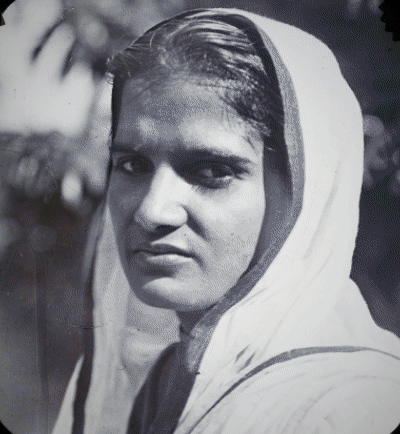

*This is a submission for the [Hacktoberfest Open-Source AI Challenge Week 4: Ghost in the Machine](https://dev.to/challenges/hacktoberfest-week4-2026-10-26)*

In Día de los Muertos there is an idea that has stayed with me: a person dies three times. Once when their body dies, once when they are buried, and a final time when the last person who remembers them is gone.

I don't have a single photo of my great-grandparents. [[One line in your own words: why, e.g. "Photographs were expensive, and the few that existed didn't survive the moves." Or simply "Nobody in my family does."]] When I started this challenge, I meant to build an ofrenda for my own family's photos, and I found I had nothing to put on it.

What I found instead were public archives full of portraits of people whose names were never written down. A woman photographed for a lantern slide around 1910. A milk-seller in a studio in the 1890s. A woman in her best sari and every ornament she owned, in the 1880s. Someone loved each of them. Nobody remembers them now.

So I built them an altar.

## What I Built

**Living Portraits** is a digital ofrenda for old photographs. You place a photo on the altar, and it comes back in one short sequence I call *the Return*:

1. The photo appears as it is today: faded, creased, black and white.
2. A line of candlelight sweeps down and mends it.
3. Colour blooms outward from their face.
4. The portrait settles into depth. Move your cursor, or tilt your phone, and it shifts gently in 3D while candlelight flickers brighter on what is nearer to you.

Every portrait carries what is known about them, which is often only this: *Her name was not recorded.*

You can place your own family's photos on it too, and save the Return as a video to send to the family group.

### The line I would not cross

My first version animated the faces: a blink, a soft smile, a slight turn of the head. When I watched it, it felt scary and awkward. [[Optional: one more sentence in your own words about how it felt.]] These are real people who can't consent to being made to smile for us.

So I threw it away. In Living Portraits **the face is never moved, re-posed or given words.** The photo comes back to life through light, colour and depth. Every download is labelled *AI-restored*.

## Demo

- **Live:** http://139.59.7.49
- **Video:** [[link to a 60-second screen recording]]

<!-- Add a screenshot of the altar page here. -->

## Code



## How I Built It

Four open-source models, chained on one server:

| Step | Model | What it does |
|---|---|---|
| Mend | GFPGAN v1.4 (Apache-2.0) | repairs blur and damage on the face |
| Colour | DDColor (Apache-2.0) | predicts colour only; the light and detail stay from the original photo |
| Depth | Depth Anything V2 Small (Apache-2.0) | estimates how near each part of the photo is |
| Check | facexlib RetinaFace + ArcFace (MIT) | finds the face, and checks it is still the same person |

The server (FastAPI) writes three images: the photo as it was, the restored photo, and a depth map. The page does the rest in a small WebGL shader: the mending sweep, the colour bloom centred on the detected face, the depth parallax and the candlelight.

### The hard part: keeping them themselves

Face-restoration models are trained to make faces look good, and "good" drifts toward young, symmetrical and generic. For people who can no longer tell us what they looked like, that drift is a small betrayal.

Three things keep it honest:

- The restored face is blended with the original (`weight=0.6` instead of 1.0).
- An ArcFace face-recognition model compares the face before and after. 10 of 11 portraits scored 0.88 or higher (median 0.94).
- DDColor's colours ran hot (magenta suits, orange hands), so I scale the colour back by 25%. Old photos look more truthful with gentler colour.

### Sepia is not colour

Most 19th-century prints are albumen prints: brown and cream, not grey. My first black-and-white detector looked at saturation, decided they were already colour photos, and skipped them.

The fix: in a toned monochrome print, colour depends only on brightness (dark brown ink, cream paper). So I fit colour as a function of brightness and look at what is left over. Real colour photos leave a lot; sepia prints leave almost nothing. It now separates all eleven archive photos correctly, plus every colourised output I tested it against.

### Running on DigitalOcean, without a GPU

Living Portraits runs on a **DigitalOcean CPU-Optimized Droplet** (4 vCPU, 8 GB) in Bangalore, as a systemd service. I planned to use a GPU Droplet, but once face animation was gone, the remaining models were light enough for CPU:

| | Laptop (RTX 3050, 4 GB) | DigitalOcean CPU Droplet |
|---|---|---|
| Time per photo | about 5 s | 11.7 s |
| Cost per photo | free | about $0.0004 |

Anyone could run their own copy for about $3 a day, or switch it off between uses. The repo has the setup script and service file.

### Where it struggles

- **Side profiles:** Rabindranath Tagore's profile portrait scored 0.74, the lowest. Face models are trained mostly on front-facing faces.
- **Colour is a guess.** DDColor doesn't know what colour her sari was. It suggests a plausible colour, and that's all it is. The page says so.
- **Faded sepia prints get only a hint of colour,** because the paper tone dominates.
- **Hand-tinted prints:** one 1860s portrait was treated as already coloured. It may genuinely be hand-tinted, so leaving it alone is the honest result.

## Why Open Innovation Matters Here

Commercial apps already make old photos "come alive". To use them you upload photos to a company's servers, usually on a subscription, and accept whatever the model decides to do to their faces.

- **I could change what the AI does.** When face animation felt wrong, I removed it. When the colours were too loud, I turned them down. When restoration drifted from the real face, I measured it. None of that is possible with a closed API.
- **The photos stay with whoever runs it.** Family photos go to a server you control, not to an AI company.
- **It can't be taken away.** No subscription to lapse, no app to shut down.
- **It's cheap:** about $0.0004 a photo on a small CPU server, or free on a laptop with a 4 GB GPU.

## The Moment It Landed

[[Write this yourself. Ideas: show the 1910 portrait to a parent or grandparent and write down what they said; or describe the moment you first watched her colour come back. Two or three honest sentences beat a long paragraph.]]

## Prize Categories

- **Best Use of DigitalOcean:** the whole app (models, API and page) runs on a DigitalOcean CPU-Optimized Droplet, deployed with the setup script and systemd service in the repo. It shows open-source image models don't need a GPU to be useful to a family.

---

*Built with help from an AI coding assistant. All portraits are public domain or CC0, from Wikimedia Commons (sources in the repo README).*
